# Chatbot — arquitetura completa

Mapa de tudo que existe em [`src/chatbot/`](../) e como se conecta ao resto do
app, ao bridge OpenClaw e ao Supabase. Todos os diagramas são **Mermaid** — o
GitHub, o VS Code (extensão Markdown Preview Mermaid) e o mermaid.live renderizam
direto.

Docs irmãos: [`shell.md`](./shell.md) (DOM/UX do shell),
[`openclaw-contract.md`](./openclaw-contract.md) (contrato HTTP front↔bridge),
[`bridge-index-and-render.md`](./bridge-index-and-render.md) (o servidor),
[`audit-logging.md`](./audit-logging.md), [`plot-chart.md`](./plot-chart.md),
[`settings-menu.md`](./settings-menu.md), [`roadmap.md`](./roadmap.md).

---

## 1. A ideia central: core neutro + host React

A regra que organiza o projeto inteiro:

> **`core/` não sabe que React existe. `react/` não sabe como o chat funciona por dentro.**

O `core/` é TypeScript puro + DOM API. Ele cria seus próprios elementos,
gerencia seu próprio estado e fala com o mundo exterior por **quatro costuras
(seams)** injetadas na configuração: `Transport`, `ChatStorage`, `RenderOptions.renderContent`
e `ChatHooks`. Trocar de framework significa reescrever só a pasta `react/`.

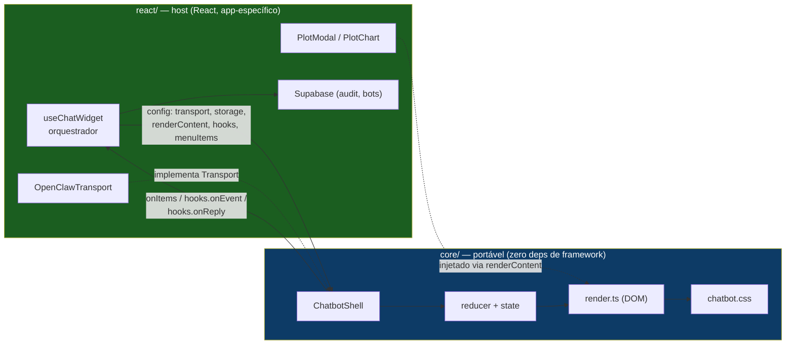

---

## 2. Mapa de arquivos e dependências

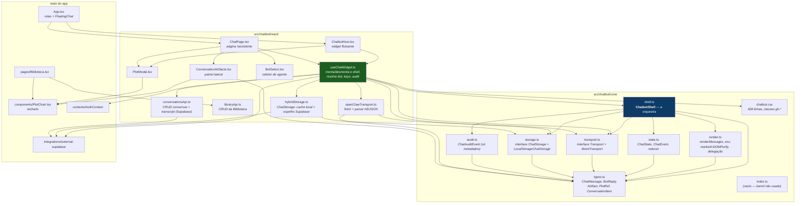

**`core/index.ts` está vazio** — todos os imports são por caminho direto
(`@/chatbot/core/shell`). Se um dia o core virar pacote, é ali que vira o barrel.

---

## 3. As quatro costuras (seams)

O que o core define como **interface** e o host preenche com **implementação**:

| Seam | Interface (core) | Implementação padrão | Implementação neste app |
|---|---|---|---|
| **Transporte** | `Transport.send(req, opts)` | `MockTransport` (eco + streaming fake) | `OpenClawTransport` (HTTP + NDJSON) |
| **Persistência** | `ChatStorage` | `LocalStorageChatStorage` | `HybridChatStorage` (cache local + espelho Supabase, por conversa) |
| **Conteúdo rico** | `RenderOptions.renderContent` | link/thumbnail estático | botão → `PlotModal` + `PlotChart` |
| **Observabilidade** | `ChatHooks.onEvent` etc. | no-op | insert em `chatbot_audit` |

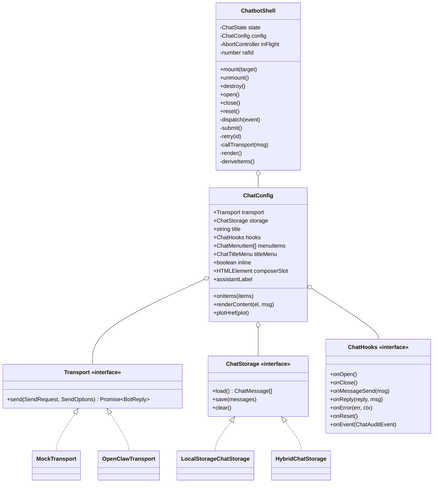

---

## 4. Máquina de estados

`state.ts` é uma função **pura** `(state, event) => state`. Sem DOM, sem async,
sem `Date.now()` — o shell constrói as mensagens (ids, timestamps) e chama o
transporte; o reducer só calcula o próximo estado. O guard de exaustividade
(`const _exhaustive: never`) quebra o build se um `ChatEvent` novo ficar sem
tratamento.

`UIStatus` é **um campo discriminado**, não um punhado de booleanos — combinações
inválidas (`isOpen && isLoading && isClosed`) são irrepresentáveis.

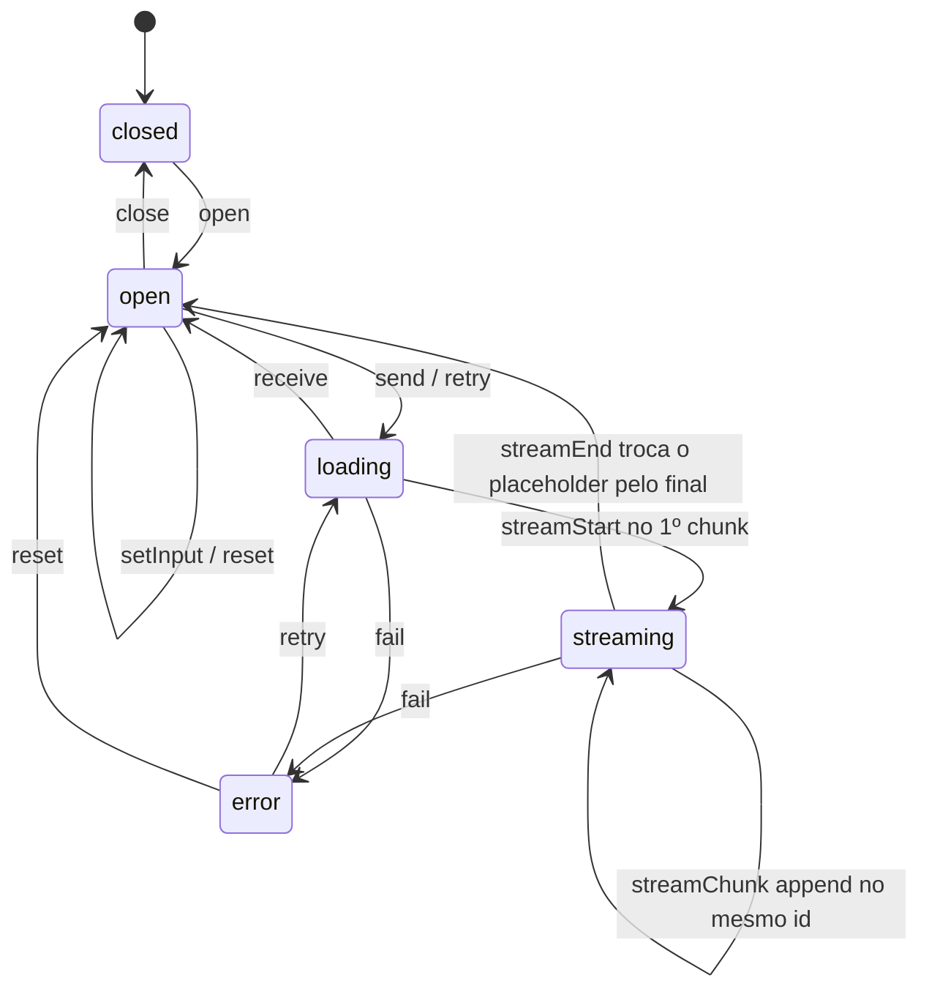

**Detalhe de performance:** `dispatch()` trata `streamChunk` de forma especial —
os renders são coalescidos em **um por frame** via `requestAnimationFrame`. Tokens
chegam mais rápido do que a tela repinta. Todo outro evento renderiza síncrono.

**Detalhe de identidade:** `render()` só reconstrói a lista quando
`state.messages !== lastMessages` (comparação por **referência**). Digitar
(`setInput`) mantém o mesmo array → nenhum rebuild de DOM enquanto se escreve.

---

## 5. Modelo de dados

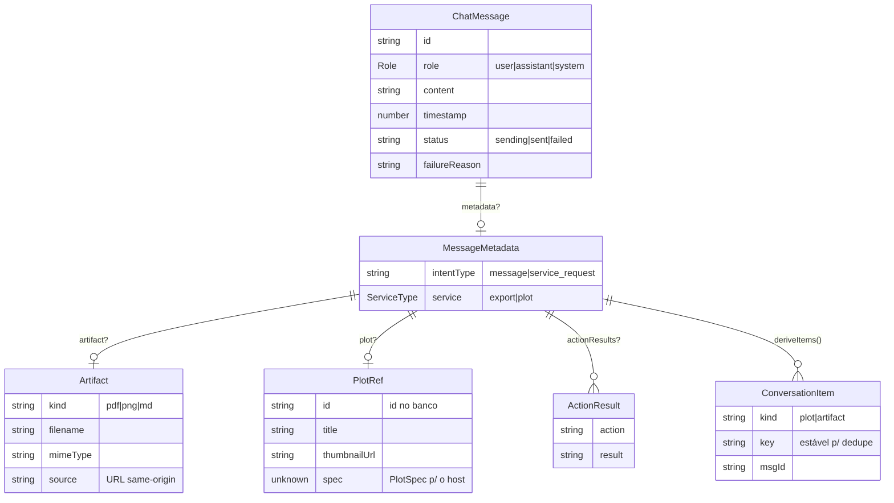

`BotReply` (o que o transporte devolve) é uma união de duas formas:

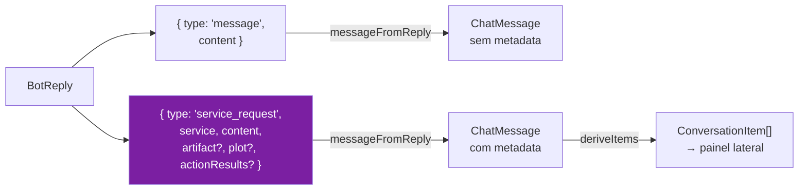

---

## 6. Ciclo de vida do mount

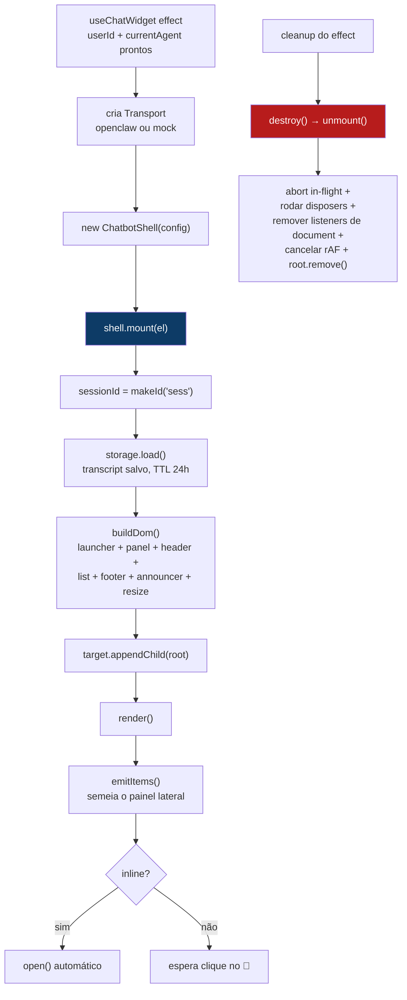

O effect tem deps `[userId, currentAgent, activeConversationId, inline]` e é
**assíncrono**: primeiro `loadTranscript(convId)` do Supabase → `seedCache()` no
localStorage → só então monta o shell (que faz `load()` síncrono do cache). Assim
**trocar de agente OU de conversa remonta o shell** com o transcript e a sessão
corretos. Uma guarda `cancelled` no cleanup evita montar se a conversa mudar no
meio do `await`. `reopenRef` reabre o painel flutuante após a remontagem.
Detalhes em [`use-chat-widget.md`](./use-chat-widget.md).

---

## 7. Árvore de DOM construída pelo shell

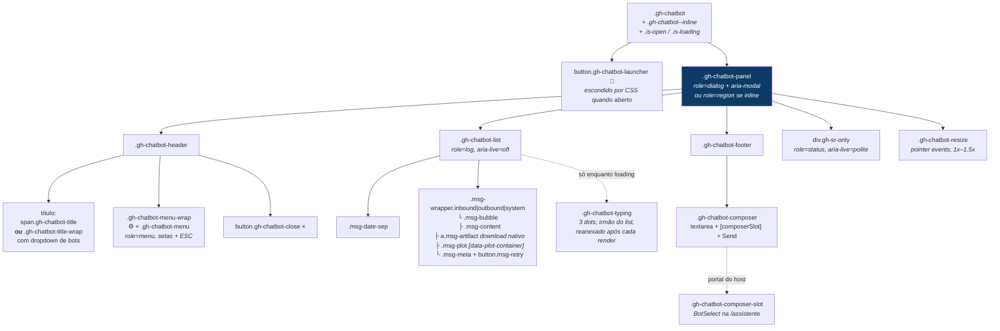

Pontos não-óbvios do DOM:

- O **indicador de digitação é irmão da lista**, não filho — o rebuild via
  `innerHTML` em `renderMessages` apagaria se estivesse dentro. Ele é
  reanexado/removido a cada `render()`.
- **Delegação de eventos**: o listener de clique fica no container estável
  (`attachListDelegation`), então sobrevive a todo rebuild de `innerHTML`.
  Downloads usam `<a download>` nativo — só o Retry precisa de JS.
- **Foco**: o keydown do trap fica em `document`, não no painel, para ESC e Tab
  funcionarem mesmo quando o clique derrubou o foco no `<body>`.
- **Segurança**: `esc()` é o único caminho para texto do usuário; resposta do bot
  vai por `marked` → `DOMPurify.sanitize`, e um hook do DOMPurify força
  `target="_blank" rel="noopener noreferrer"` em todo `<a>`.

---

## 8. Fluxo de uma mensagem (streaming)

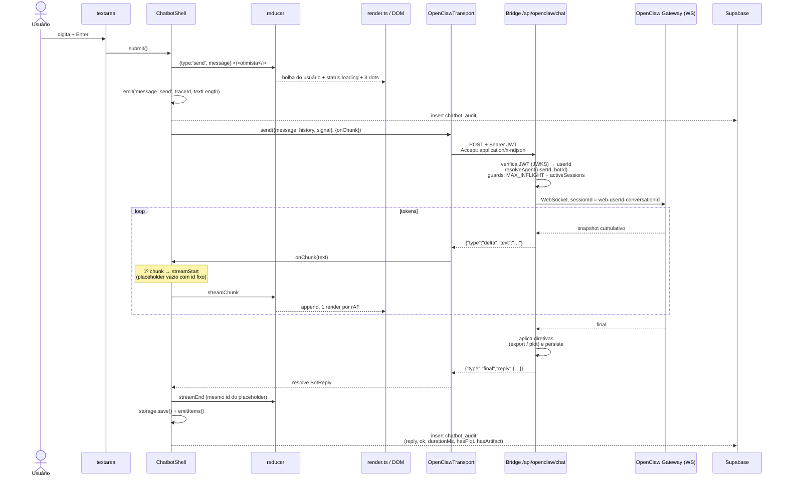

**Por que o id do assistente é criado antes do stream:** `streamStart` e
`streamEnd` precisam ser **a mesma entrada da lista**, senão o texto que cresceu
apareceria duplicado ao lado da versão final.

O frame `final` é **autoritativo**: uma resposta de plot/export transmite o texto
por deltas, mas os metadados estruturados (`plot`/`artifact`) só chegam no final.
Se o stream terminar sem `final`, o transporte cai no acumulado (`acc`) como
fallback defensivo.

### Caminho de erro

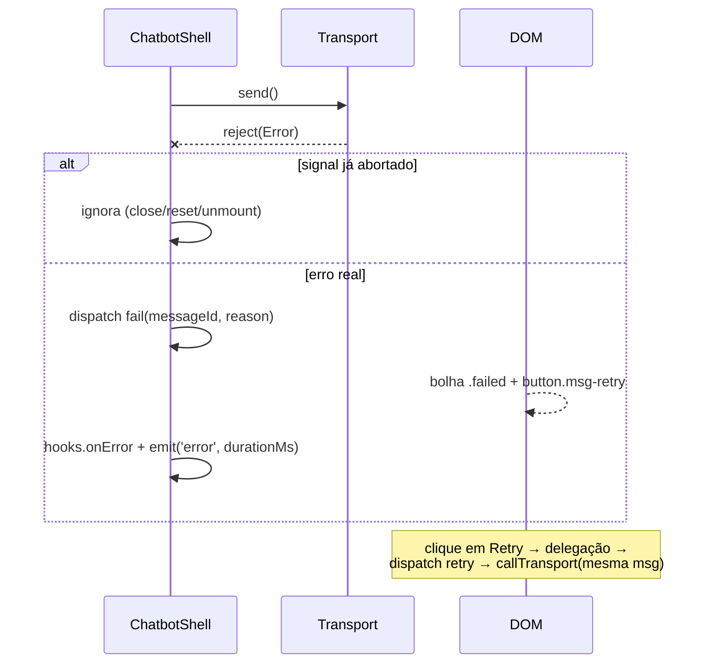

Status HTTP relevantes do bridge: **409** quando já existe um turno rodando na
mesma sessão (evita que o Gateway aborte a resposta quase pronta), **503** no cap
global de concorrência, **401/403** em auth/gating.

---

## 9. Deliverables: plots e documentos

Um `service_request` produz metadados na mensagem. Daí saem **três destinos**:

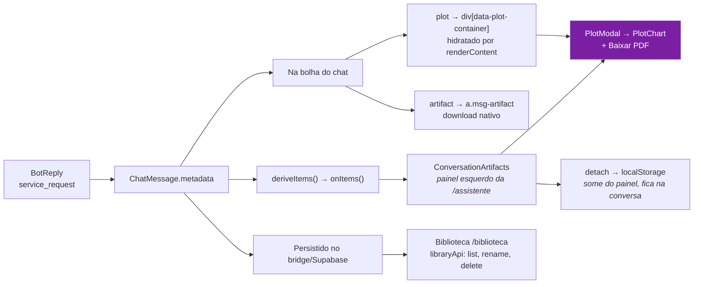

`deriveItems()` roda no **mount**, em **cada reply finalizado** e no **reset** —
nunca por frame de streaming. `key` (`plot:<id>` / `artifact:<msgId>:<filename>`)
é o identificador estável usado para dedupe e para o conjunto de "detached".

O `renderContent` é o ponto onde o React entra num core sem React: o core cria um
`
` vazio, o host preenche imperativamente com um `<button>` que chama
`setActivePlot(...)`. O contrato exige **idempotência** — ele roda a cada
re-render.

---

## 10. Os dois modos de montagem

```mermaid
graph TB
    subgraph F["Flutuante — ChatbotHost"]
        F1["App.tsx → FloatingChat<br/><i>escondido em /assistente</i>"]
        F2["useChatWidget(ref, {inline:false})"]
        F3["launcher 💬 + panel 360x520<br/>redimensionável até 1.5x"]
        F4["role=dialog, aria-modal,<br/>focus trap, ESC fecha"]
        F5["troca de bot: dropdown no header<br/>(titleMenu)"]
    end

    subgraph I["Página cheia — ChatPage (/assistente)"]
        I1["lazy route + DashboardLayout flush"]
        I2["useChatWidget(ref, {inline:true, composerSlot})"]
        I3["sem launcher, sem resize,<br/>abre sozinho, ocupa h-full"]
        I4["role=region, sem trap, ESC não fecha"]
        I5["troca de bot: BotSelect portado<br/>para o composerSlot do footer"]
        I6["ConversationArtifacts<br/>coluna 300px à esquerda"]
    end

    F2 --> S["mesmo ChatbotShell<br/>flag config.inline"]
    I2 --> S

    style S fill:#0d3b66,color:#fff
```

A flag `inline` desliga, dentro do core: launcher, `close()`, focus trap, ESC,
`titleMenu` e o handle de resize — e chama `open()` no mount.

---

## 11. Seleção de agente e permissões

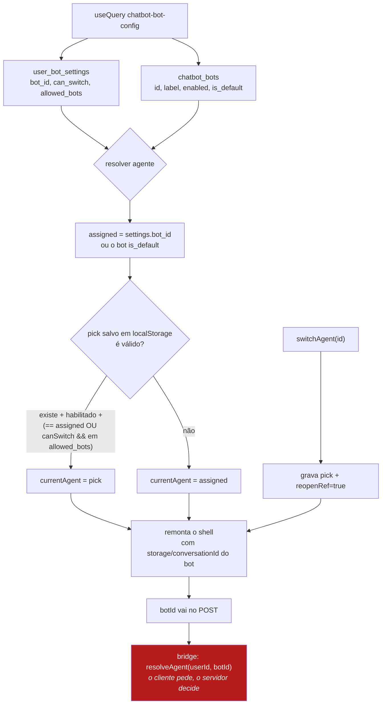

O `botId` enviado pelo cliente é **um pedido, não autoridade** — o bridge relê
`chatbot_bots` + `user_bot_settings` (cache ~30s) e rejeita com 400/403. A UI de
atribuição por usuário está em [`components/admin/UserBotSettings.tsx`](../../components/admin/UserBotSettings.tsx).

---

## 12. Persistência: Supabase (verdade) + cache local

**Multi-conversa:** um bot tem **N conversas**, cada uma com contexto/memória
própria. A fonte durável é o **Supabase** (sincroniza entre dispositivos); o
localStorage é só **cache** pra o `load()` síncrono do core.

**Supabase (fonte da verdade):**

| Tabela | Conteúdo | RLS |
|---|---|---|
| `chatbot_conversations` | lista de tópicos: `id, user_id, bot_id, title, created_at, updated_at` (o `id` **é** o `conversationId`) | dono (`auth.uid() = user_id`) |
| `chatbot_transcripts` | blob por conversa: `conversation_id (pk), user_id, messages jsonb, updated_at`; `on delete cascade` da conversa | dono |

**localStorage (cache + preferências):**

| Chave | Papel |
|---|---|
| `…:{botId}:{userId}:{convId}:transcript` | **cache** do blob (via `HybridChatStorage`); espelhado no Supabase a cada `save` |
| `…:{botId}:{userId}:activeConversation` | última conversa usada naquele bot |
| `…:{userId}:agent` | bot escolhido pelo usuário |
| `…:{botId}:{userId}:{convId}:detached` | `ConversationItem.key[]` escondidos do painel, **por conversa** |

Toda leitura/escrita de localStorage é `try/catch` silencioso — nunca derruba o chat.

> **Multi-conversa e memória:** cada conversa tem `id` próprio → `sessionId =
> web-{userId}-{hash(agentId, convId)}` no OpenClaw → **memória isolada por
> conversa**. "Iniciar nova conversa" agora **cria** um tópico (não apaga o
> atual): `hooks.onReset` → `newConversation()`. `storage.clear()` limpa só o
> cache local, nunca o Supabase. Apagar de verdade é o "Apagar tópico"
> (`deleteConversation`; o transcript vai junto por cascade).

> **Sync vs async:** o `ChatStorage` do core é **síncrono**. Por isso o
> `useChatWidget` **semeia** o cache com o transcript do Supabase **antes** de
> montar o shell, e o `HybridChatStorage` espelha os `save` de volta (fire-and-
> forget). Detalhes em [`use-chat-widget.md`](./use-chat-widget.md).

---

## 13. Auditoria

`ChatAuditEvent` carrega **só metadados** — nunca texto de conversa. `textLength`
existe; `text` não. O core emite; o host decide o destino (aqui, um insert em
`chatbot_audit`).

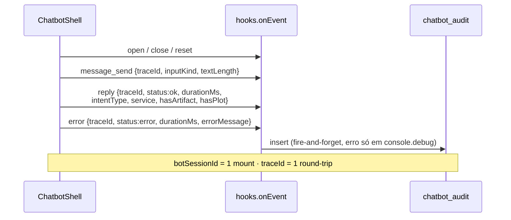

---

## 14. Do navegador ao Gateway

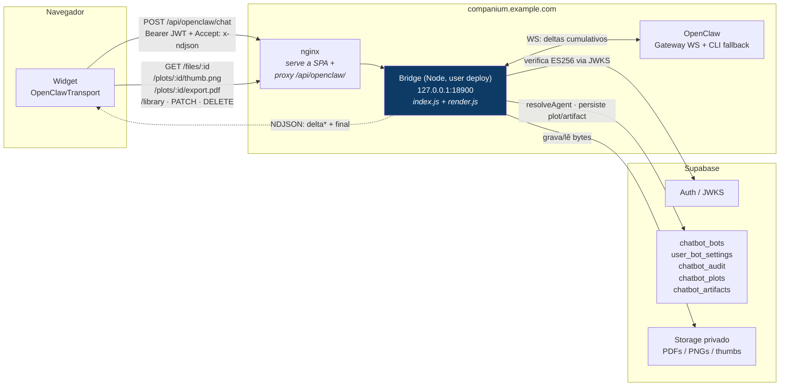

Chaveamento por env no front:

- `VITE_CHATBOT_BACKEND=openclaw` → `OpenClawTransport`; qualquer outro valor →
  `MockTransport` (700 ms, eco, **nunca toca a rede**).
- `VITE_OPENCLAW_ENDPOINT` (default `/api/openclaw/chat`) — o `apiBase` das
  outras rotas é derivado tirando o sufixo `/chat`.

Downloads via `<a download>` não conseguem mandar header `Authorization`; por isso
o bridge assina um **capability token** HMAC do id da linha (`?t=`), e as rotas de
download aceitam token **ou** JWT — é assim que o botão "Baixar PDF" do modal
consegue usar `fetch` com o JWT.

---

## 15. Onde o chatbot toca o resto do app

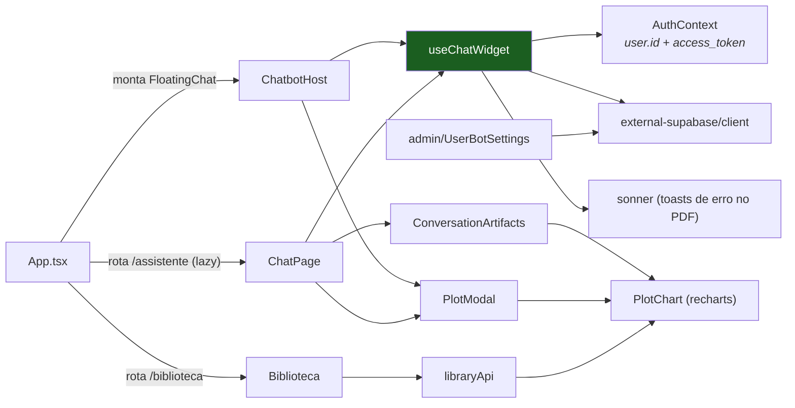

---

## 16. Invariantes que não devem ser quebrados

1. **`core/` nunca importa React, `@/components/*` ou o cliente Supabase.** Se
   precisar de algo do app, vira uma costura na `ChatConfig`.
2. **`reducer` continua puro.** Ids, timestamps e chamadas assíncronas ficam no
   shell — é isso que torna a conversa inteira testável sem DOM.
3. **`esc()` é o único caminho para texto do usuário.** Markdown do bot passa
   obrigatoriamente por `DOMPurify`.
4. **`renderContent` é idempotente** — roda em todo re-render.
5. **`streamStart` e `streamEnd` compartilham o mesmo message id.**
6. **O frame `final` do NDJSON é autoritativo** para metadados estruturados.
7. **`openclaw-contract.md` e `openClawTransport.ts` mudam juntos.**
8. **Auditoria não carrega texto cru** — só forma e metadados.
9. **`emitItems()` fora do caminho de streaming** — mount, reply finalizado e
   reset apenas.
10. **Storage falha em silêncio**, nunca derruba o chat.

---

## 17. Estado atual e próximos passos

Já entregue: core portável, streaming ponta a ponta (NDJSON ↔ WS do Gateway),
Markdown sanitizado, multi-agente com gating server-side, plots interativos no
chat e no painel, exports em PDF/PNG, Biblioteca com CRUD, auditoria persistida.

**Multi-conversa (em andamento):** camada de dados no Supabase
(`chatbot_conversations` + `chatbot_transcripts`), `HybridChatStorage` e o
refactor do `useChatWidget` (conversa ativa, remontagem por conversa) já estão
prontos. **Falta a UI** — a lista de conversas à esquerda (`ConversationList`
com menu de renomear/apagar), mover o painel de artifacts pra direita, o título
automático da 1ª mensagem e a migração do transcript local antigo. Veja
[`use-chat-widget.md`](./use-chat-widget.md).

Pendências priorizadas em [`roadmap.md`](./roadmap.md) — as principais: OpenClaw
sob systemd (hoje roda em `tmux`), rate limiting por usuário, testes automatizados
do reducer, página `/plots/:id` (o link do fallback hoje cai no NotFound),
responsividade mobile e o stub de "Reportar um bug".
