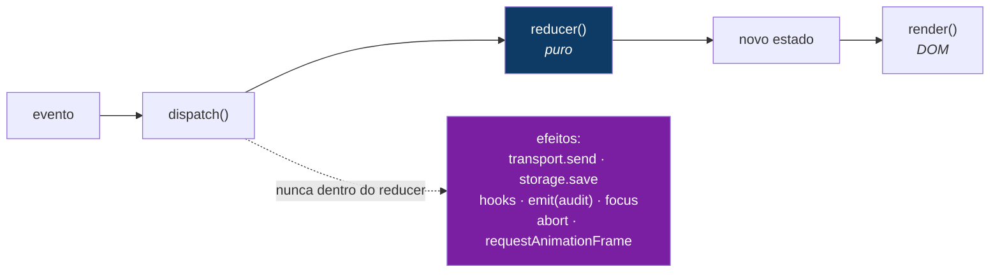
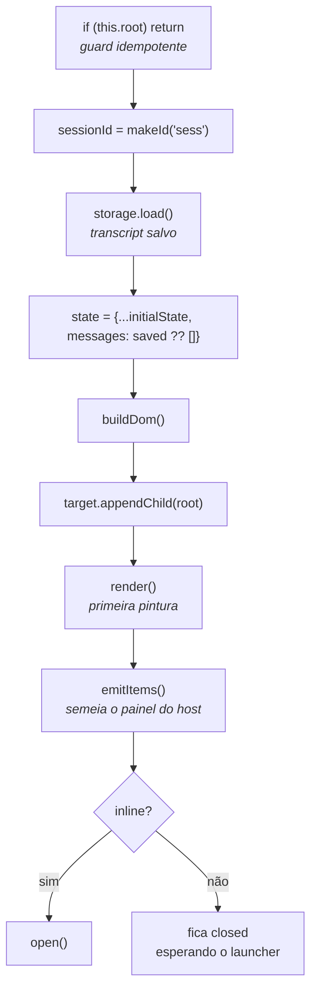
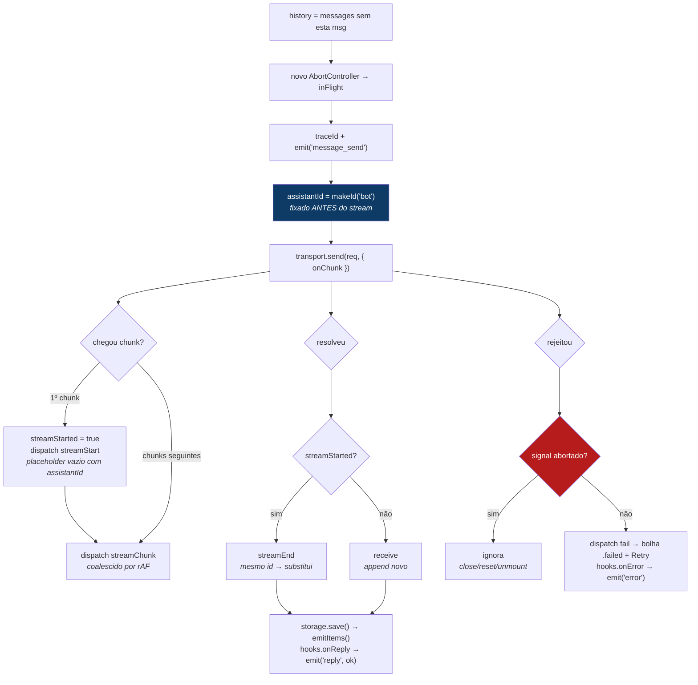

# `shell.ts` — o orquestrador do core

Passeio completo por [`src/chatbot/core/shell.ts`](../core/shell.ts) (869 linhas):
o que é, a única ideia que amarra tudo, e como cada campo e método funciona —
já com **streaming**, **auditoria**, **menus do header**, **modo inline** e
**deliverables da conversa**.

Docs irmãos: [`architecture.md`](./architecture.md) (visão geral do sistema),
[`use-chat-widget.md`](./use-chat-widget.md) (o host React que instancia o shell),
[`settings-menu.md`](./settings-menu.md), [`audit-logging.md`](./audit-logging.md).

---

## 1. O que o `shell.ts` é

É o **orquestrador** — o único lugar do core onde todas as outras peças se
encontram. Cada módulo vizinho é deliberadamente parcial:

| Módulo | O que é | O que não é |
|---|---|---|
| [`types.ts`](../core/types.ts) | formas de dados | nenhum comportamento |
| [`state.ts`](../core/state.ts) | lógica **pura** (`reducer`) | sem DOM, sem async |
| [`render.ts`](../core/render.ts) | estado → DOM | sem lógica, não é dono do estado |
| [`transport.ts`](../core/transport.ts) | fala com um backend | não sabe nada de UI |
| [`storage.ts`](../core/storage.ts) | persistência | não sabe nada de UI |
| [`audit.ts`](../core/audit.ts) | forma do evento de log | não sabe o destino |

Nenhum deles conhece o outro. O `shell.ts` é o maestro que **é dono do estado,
constrói o DOM, chama o transporte, salva no storage, emite auditoria e
re-renderiza** — e é o que o host realmente instancia: `new ChatbotShell(config)`.

---

## 2. A ideia central: reducer puro, efeitos na borda

Tudo no arquivo se organiza em torno de uma regra da máquina de estados:
**o reducer é puro; todo efeito colateral mora aqui.**



Ao ler um método, pergunte: *isso está calculando o próximo estado* (delega pro
reducer) *ou causando um efeito* (faz aqui)? Essa divisão é o motivo de a lógica
de conversa ser testável sem browser — e de este arquivo ser a única parte
"suja", que toca o mundo real.

---

## 3. Helpers de módulo

### `makeId(prefix)` — [`shell.ts:63-68`](../core/shell.ts#L63-L68)

```ts
let idCounter = 0;
function makeId(prefix: string): string {
  idCounter++;
  return `${prefix}-${Date.now()}-${idCounter}`;
}
```

Ids únicos e estáveis: `temp-…` (mensagem otimista do usuário), `bot-…`
(resposta), `sess-…` (sessão de auditoria), `trace-…` (um round-trip),
`ghbot-…` (base dos ids ARIA). `Date.now()` separa no tempo; o contador de módulo
desempata dentro do mesmo milissegundo. É impuro — por isso vive **aqui**, e não
no reducer.

O `idCounter` é de módulo: sobrevive a mounts/unmounts e zera só em reload / nova
aba / HMR. Não é persistido (ao contrário das mensagens).

### `messageFromReply(reply, id?)` — [`shell.ts:72-93`](../core/shell.ts#L72-L93)

O **tradutor** entre o mundo do transporte e o do modelo. O transporte devolve
`BotReply`; o estado só guarda `ChatMessage`:

- `type: 'message'` → mensagem simples do assistente.
- `type: 'service_request'` → mensagem com `metadata` carregando `intentType`,
  `service` e o que vier de `artifact` / `plot` / `actionResults`. É essa metadata
  que o `render.ts` lê depois para desenhar o link de download ou o placeholder
  do gráfico.

O parâmetro `id` é o detalhe que faz o streaming fechar: quando houve stream, a
resposta final **reusa o id do placeholder**, então `streamEnd` substitui a mesma
entrada da lista em vez de duplicá-la.

---

## 4. A superfície de configuração

### `ChatConfig extends RenderOptions` — [`shell.ts:51-61`](../core/shell.ts#L51-L61)

O único saco de config que o host passa. Sem `?` = o core não funciona sem;
com `?` = o core tem um default sensato.

| Campo | Obrigatório | Papel |
|---|---|---|
| `transport` | ✅ | como falar com o backend ([`Transport`](../core/transport.ts)) |
| `storage` | — | persistência; default `LocalStorageChatStorage`. O host passa `HybridChatStorage` (cache local + espelho no Supabase) |
| `title` | — | texto do header quando não há `titleMenu` |
| `hooks` | — | observação: `onOpen`, `onClose`, `onMessageSend`, `onReply`, `onError`, `onReset`, `onEvent` |
| `menuItems` | — | itens do menu ⚙; default: só "Start new conversation" |
| `titleMenu` | — | dropdown de troca de bot no header. O core o monta sempre que recebe; é o **host** que não passa no modo inline (lá o seletor é o `BotSelect` no `composerSlot`) |
| `inline` | — | `true` = embutido na página: sem launcher, sem resize, sem trap, abre no mount |
| `composerSlot` | — | elemento do host inserido no footer, à esquerda do Send |
| `onItems` | — | recebe os `ConversationItem[]` (plots/documentos) da conversa |
| `assistantLabel` | — | *(de `RenderOptions`)* nome mostrado acima das bolhas do bot |
| `renderContent` | — | *(de `RenderOptions`)* delegate do host para conteúdo rico; **precisa ser idempotente** |
| `plotHref` | — | *(de `RenderOptions`)* fallback de link do plot; default `/plots/:id` |

### Os tipos auxiliares dos menus — [`shell.ts:29-46`](../core/shell.ts#L29-L46)

- **`ChatMenuApi`** — o que um item de menu pode acionar: `reset()`, `close()`,
  `closeMenu()`. Existe para que itens definidos pelo host reusem as ações
  embutidas em vez de reimplementá-las.
- **`ChatMenuItem`** — `{ label, onSelect(api) }`.
- **`ChatTitleMenu`** — `{ label, options, currentId, enabled, onSelect }`. Com
  `enabled: false` o botão fica cinza e não interativo (`aria-disabled`).

### `ChatHooks` — [`shell.ts:15-24`](../core/shell.ts#L15-L24)

Callbacks de observação. O core **dispara**; o host **decide** o que fazem — é
assim que o core continua ignorante sobre logging. Neste app: `onEvent` insere em
`chatbot_audit` e `onReset` cria uma conversa nova no Supabase.

---

## 5. Os campos da classe

```ts
// estado
private state: ChatState            // única fonte de verdade (de state.ts)
private config: ChatConfig          // o que o host passou
private storage: ChatStorage        // storage resolvido (do config ou o default)
private inline = false              // cópia de config.inline

// refs de DOM — capturadas em buildDom(), zeradas em unmount()
target, root, listEl, typingEl, textarea, sendBtn, launcher, panel, announcer
menuWrap, menu, optionsBtn                       // menu ⚙
titleWrap, titleBtn, titleMenuEl, titleMenuOpen  // dropdown de bots

// bookkeeping
private disposers: Array<() => void>       // um teardown por listener
private inFlight: AbortController | null   // request atual, cancelável
private rafId: number | null               // render de stream pendente (coalescido)
private lastMessages: ChatMessage[] | null // guard de identidade do render

// acessibilidade / auditoria
private previouslyFocused: HTMLElement | null  // p/ devolver o foco no close()
private domId = makeId('ghbot')                // base única dos ids ARIA
private sessionId: string                      // uma sessão por mount
private menuOpen = false
```

Quatro grupos: **estado** (o que mostrar), **refs** (onde mostrar), **bookkeeping**
(como limpar e evitar corrida) e **a11y/auditoria**. O array `disposers` e o
`inFlight` são os dois mecanismos que deixam o `unmount()` livre de leaks.

---

## 6. Ciclo de vida

### `constructor(config)` — [`shell.ts:146-150`](../core/shell.ts#L146-L150)

Guarda o config e **resolve o storage uma vez**
(`config.storage ?? new LocalStorageChatStorage()`). Depois dessa linha o resto da
classe só toca `this.storage`. Não constrói DOM: construir é barato e sem efeito
— o DOM espera o `mount()`.

### `mount(target)` — [`shell.ts:154-168`](../core/shell.ts#L154-L168)



Uma **sessão de auditoria por mount** (`sessionId`), e o painel nasce `closed`
(vem do `initialState.status`) — exceto no modo inline, que chama `open()` para
já ficar visível e disparar `onOpen`/auditoria.

### `unmount()` — [`shell.ts:170-197`](../core/shell.ts#L170-L197)

O espelho do mount, com quatro movimentos anti-leak:

1. `inFlight?.abort()` — cancela o request pendente, para que uma resposta
   atrasada não faça `dispatch` em DOM morto.
2. `disposers.forEach(d => d())` — cada `addEventListener` registrou seu removedor.
3. `document.removeEventListener` dos dois handlers de clique-fora (menu ⚙ e
   dropdown de bots) — eles vivem no `document`, não no painel.
4. `cancelAnimationFrame(rafId)` — descarta um render de stream agendado.

Depois disso a instância fica dormente, mas poderia ser remontada.

### `destroy()` — [`shell.ts:199-202`](../core/shell.ts#L199-L202)

`unmount()` + solta o `target`. É o teardown terminal — o que o `useEffect` do
host chama na limpeza. A distinção é semântica: "poderia ser reusado" vs.
"acabou".

---

## 7. Ações públicas

Todas seguem o mesmo compasso: **dispatch → hook → auditoria → efeito**.

### `open()` — [`shell.ts:206-220`](../core/shell.ts#L206-L220)

Guarda quem tinha o foco (`previouslyFocused`), despacha `open`, chama
`hooks.onOpen`, emite o evento de auditoria, foca a textarea — e força o scroll
para o fim **no próximo frame**:

> O auto-scroll condicional do `renderMessages` não consegue disparar antes de o
> painel ter altura resolvida (mount inline), nem quando se abre com histórico
> longo (`scrollTop` 0 lê como "não está perto do fim"). Daí o
> `requestAnimationFrame`.

### `close()` — [`shell.ts:223-234`](../core/shell.ts#L223-L234)

No-op quando `inline` (página cheia não fecha). Fecha os menus **primeiro**,
despacha `close`, dispara hook + auditoria e **devolve o foco** para quem abriu
(ou para o launcher).

### `reset()` — [`shell.ts:236-242`](../core/shell.ts#L236-L242)

Despacha `reset` (limpa as mensagens do estado), chama **`storage.clear()`**
(limpa o cache local), emite auditoria, dispara `hooks.onReset` e re-emite os
items (agora vazios). Repare que o efeito (`storage.clear`) mora aqui, não no
reducer.

> ⚠️ `clear()` do `HybridChatStorage` apaga **só o cache local** — nunca o
> Supabase. E limpar o transcript **não** reseta a memória do bot: quem carrega
> contexto é o `conversationId` (o host troca por um novo no `onReset`).

---

## 8. `dispatch(event)` — o batimento — [`shell.ts:267-280`](../core/shell.ts#L267-L280)

```ts
this.state = reducer(this.state, event);
if (event.type === 'streamChunk') {
  if (this.rafId === null)
    this.rafId = requestAnimationFrame(() => { this.rafId = null; this.render(); });
} else {
  if (this.rafId != null) { cancelAnimationFrame(this.rafId); this.rafId = null; }
  this.render();
}
```

O **único ponto de mudança de estado** do shell — nada mais escreve em
`this.state`. E é aqui que vive a otimização do streaming: **tokens chegam mais
rápido do que a tela repinta**, então os renders de `streamChunk` são coalescidos
em **um por frame**. Qualquer outro evento cancela o frame pendente e renderiza
**síncrono**, para a UI continuar instantânea no clique/tecla.

---

## 9. `buildDom()` — a árvore e o wiring — [`shell.ts:371-700`](../core/shell.ts#L371-L700)

O método mais longo. Cria a hierarquia (detalhada em
[`architecture.md` §7](./architecture.md)) e, para **cada** listener, empurra um
disposer:

```ts
launcher.addEventListener('click', onLauncher);
this.disposers.push(() => launcher.removeEventListener('click', onLauncher));
```

O que ele monta, em ordem:

- **Launcher** `💬` — `aria-haspopup="dialog"`, `aria-expanded` espelhado no
  `render()`. O CSS o esconde quando `.is-open`.
- **Panel** — `role="dialog"` + `aria-modal` no modo flutuante;
  `role="region"` quando inline. Sempre `aria-labelledby` apontando pro título.
- **Header** com três coisas:
  - **Título**: um `<span>` simples, **ou** o dropdown de bots quando há
    `titleMenu`. O label reserva a largura do nome mais longo
    (`minWidth: ${longest}ch`) para o botão não "pular" ao trocar de bot.
  - **⚙ Settings**: SVG inline com `fill="currentColor"` — um emoji ⚙️ ficaria
    cinza independente do CSS. Abre `.gh-chatbot-menu` com `role="menu"`,
    navegação por setas, `Escape`/`Tab` fecham e devolvem o foco ao gear
    ([`onMenuKeydown`](../core/shell.ts#L359-L369)).
  - **×** Close.
- **Resize handle** — pointer events com `setPointerCapture`, ancorado no canto
  inferior-direito: mover pra cima/esquerda **cresce** o painel, limitado a
  1×–1.5× de `360×520`.
- **Lista** — `role="log"`, `aria-live="off"` (o rebuild é por `innerHTML`; o
  anúncio vai pelo announcer dedicado) + `attachListDelegation` para o Retry.
- **Typing indicator** — três dots. É **irmão** da lista, não filho: o
  `innerHTML` do `renderMessages` o apagaria. O `render()` o reanexa/remove.
- **Footer / composer** — textarea + (opcional) `composerSlot` do host + Send,
  dentro de `.gh-chatbot-composer` para o CSS estilizar como uma pílula.
- **Announcer** — `.gh-sr-only` com `role="status"` e `aria-live="polite"`.

E três wirings de input:

- `onInput` → `autoGrowTextarea()` + `dispatch(setInput)`.
- `onKey` → **Enter envia**, Shift+Enter insere newline.
- `onSend` → `submit()`.

### O keydown do documento — [`shell.ts:650-684`](../core/shell.ts#L650-L684)

Fica no **`document`**, não no painel, de propósito: assim `Escape` e o focus
trap funcionam mesmo quando o usuário clicou na lista e o foco caiu no `<body>`
(fora do painel). É guardado para ser no-op quando `inline` ou `closed`.

A ordem do `Escape` importa: **dropdown de bots → menu ⚙ → painel**. E o `Tab`
faz o ciclo entre o primeiro e o último focável ([`getFocusable`](../core/shell.ts#L290-L298)
só considera elementos visíveis, via `offsetParent !== null`); se o foco escapou
do painel, ele é puxado de volta.

---

## 10. O envio

### `submit()` — [`shell.ts:702-717`](../core/shell.ts#L702-L717)

O padrão de **mensagem otimista**: o `send` coloca a bolha do usuário na tela
*imediatamente* (`status: 'sending'`) e vira `loading` — feedback antes da rede.
Lê `this.state.input` (fonte de verdade), não o DOM. Guardas: texto vazio, ou
status `loading`/`streaming`.

### `retry(id)` — [`shell.ts:719-724`](../core/shell.ts#L719-L724)

Acionado pelo botão delegado. Reusa **o mesmo objeto de mensagem** (mesmo id),
volta pra `sending` via o evento `retry` e re-chama o transporte. As guardas
impedem retry de mensagem que não é do usuário ou empilhar requests.

### `callTransport(userMsg, inputKind)` — [`shell.ts:726-803`](../core/shell.ts#L726-L803)

O motor de efeitos. Onde o async e o mundo externo vivem.



Detalhes que importam:

- **`history` exclui a mensagem recém-enviada**, para o backend receber o contexto
  anterior separado da entrada nova.
- **O `assistantId` é criado antes do stream.** `streamStart` e `streamEnd` têm
  que ser **a mesma entrada da lista**, senão o texto que cresceu apareceria
  duplicado ao lado da versão final.
- **`onChunk` é defensivo**: ignora chunk vazio e chunk após abort.
- **O guard de corrida** (`if (controller.signal.aborted) return`) está nos dois
  ramos — `.then` e `.catch`. Uma resposta que chega depois do teardown nunca
  despacha numa instância morta.
- **`emitItems()` roda no reply finalizado**, porque um plot/artifact pode ter
  acabado de nascer — nunca por frame de streaming.
- **`finally`** limpa o `inFlight` só se ainda for *este* controller (um request
  mais novo pode tê-lo substituído).

---

## 11. `render()` — a projeção — [`shell.ts:805-860`](../core/shell.ts#L805-L860)

Chamado depois de cada dispatch. Cinco responsabilidades:

1. **Classes no root** — `.is-open` (status ≠ `closed`) e `.is-loading`. O shell
   só alterna classes; o [`chatbot.css`](../core/chatbot.css) decide a aparência.
   Nada de show/hide hardcoded em JS.
2. **Estado pra tecnologia assistiva** — `aria-expanded` no launcher, `aria-busy`
   na lista.
3. **O guard de identidade** — `renderMessages` reconstrói tudo via `innerHTML`,
   então só roda quando a **referência** do array mudou. `setInput`/`open`/`close`
   reusam o mesmo array (o reducer espalha o estado mas mantém `messages`), logo
   **digitar não reconstrói a lista** nem faz o cursor pular. No mesmo bloco, a
   última mensagem não-usuário é copiada pro announcer — mas **não durante o
   streaming**, para o leitor de tela não tagarelar a cada token.
4. **Typing indicator** — presente como último item da lista só enquanto
   `loading`, reanexado após cada rebuild (que apaga a lista) para rolar junto com
   as mensagens.
5. **Sync da textarea e do Send** — só escreve no DOM quando difere de
   `state.input` (depois de digitar já são iguais: no-op, cursor a salvo; depois
   de `send`/`reset` o estado é `''` e isso limpa a caixa). O Send fica desabilitado
   em `loading`, `streaming` ou input vazio.

### `renderOpts()` — [`shell.ts:862-868`](../core/shell.ts#L862-L868)

Adaptador de três linhas que extrai os campos de `RenderOptions` do `ChatConfig` e
entrega ao `renderMessages`. É a outra metade do "`extends RenderOptions` passa
adiante".

---

## 12. Deliverables: `deriveItems()` / `emitItems()` — [`shell.ts:247-263`](../core/shell.ts#L247-L263)

Varre as mensagens e deriva os **entregáveis** da conversa a partir da metadata:

```ts
{ kind: 'plot',     key: `plot:${plot.id}`,                    … }
{ kind: 'artifact', key: `artifact:${m.id}:${art.filename}`,   … }
```

O `key` é o identificador estável usado pelo host para dedupe e para o conjunto de
itens "detached". `emitItems()` é chamado em **três momentos** — `mount`, cada
reply finalizado e `reset` — e entrega tudo pro `config.onItems`, que no host
alimenta o painel lateral. O core não sabe o que é um painel.

---

## 13. `emit()` e a auditoria — [`shell.ts:283-287`](../core/shell.ts#L283-L287)

```ts
private emit(e: Partial<ChatAuditEvent> & { type: ChatAuditEventType }): void {
  const hook = this.config.hooks?.onEvent;
  if (!hook) return;
  hook({ botSessionId: this.sessionId, timestamp: Date.now(), ...e });
}
```

Preenche os campos constantes e encaminha. Sem hook, é no-op — o core não conhece
destino algum. Os eventos: `open`, `close`, `reset`, `message_send`, `reply`,
`error`. Duas correlações:

- **`botSessionId`** = uma sessão do widget (um mount).
- **`traceId`** = um round-trip, ligando `message_send` ao `reply`/`error`.

**Só metadados** — `textLength` existe, `text` não. Detalhes em
[`audit-logging.md`](./audit-logging.md).

---

## 14. Um round-trip completo

1. Você digita → evento `input` → `dispatch(setInput)` → reducer atualiza `input`
   (mesmo array de mensagens) → `render()` sincroniza a caixa e habilita o Send,
   **sem rebuild da lista**.
2. Enter → `submit()` monta a `ChatMessage` otimista → `dispatch(send)` → reducer
   anexa, limpa o input e vira `loading` → `render()` mostra sua bolha e os três
   dots na hora. `emit('message_send')` vai pra auditoria.
3. `callTransport()` → `transport.send(req, { onChunk })`.
4. Primeiro token → `streamStart` (placeholder vazio) → cada token seguinte →
   `streamChunk`, com render coalescido a um por frame.
5. O `BotReply` final resolve → `messageFromReply(reply, assistantId)` →
   `streamEnd` substitui o placeholder pela versão final (texto completo +
   metadata de plot/artifact) → `storage.save()` → `emitItems()` →
   `hooks.onReply` → `emit('reply', { status:'ok', durationMs, … })`.
6. (Ou rejeita → `dispatch(fail)` → bolha marcada com botão Retry →
   `hooks.onError` → `emit('error')`.)

Tudo passa por `dispatch()` (estado) e `render()` (DOM), com
`callTransport`/`storage`/`hooks`/`emit` como os efeitos nas bordas. É o shell
inteiro.

---

## 15. Invariantes do arquivo

1. **Só o `dispatch()` escreve em `this.state`.**
2. **Nenhum efeito dentro do reducer** — ids, timestamps, rede, storage e foco
   ficam aqui.
3. **Todo listener empurra um disposer**; listeners de `document` são removidos
   explicitamente no `unmount()`.
4. **`streamStart` e `streamEnd` compartilham o mesmo message id.**
5. **`streamChunk` é o único evento coalescido por frame.**
6. **Os dois ramos do transporte checam `signal.aborted`** antes de despachar.
7. **A lista só é reconstruída quando a referência de `messages` muda.**
8. **O typing indicator é irmão da lista**, nunca filho.
9. **`emitItems()` nunca roda por frame de streaming.**
10. **O core não conhece React, Supabase nem HTTP** — tudo isso entra por
    `ChatConfig`.

---

## 16. O que o shell **não** faz

Fica no host ([`use-chat-widget.md`](./use-chat-widget.md)) — de propósito:

- Escolher/autorizar o bot, e o gating server-side.
- Saber o que é uma "conversa": o shell tem um transcript; multi-conversa,
  `conversationId` e sincronização com o Supabase são do host.
- Renderizar gráficos (entra por `renderContent`), abrir modal, baixar PDF.
- Persistir auditoria (entra por `hooks.onEvent`).
- Decidir o destino do transcript (entra por `storage`).
