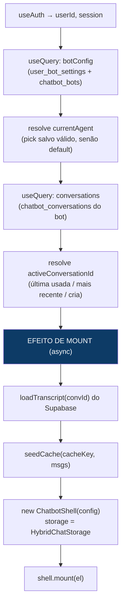

# `useChatWidget` — o orquestrador React

[`src/chatbot/react/useChatWidget.ts`](../react/useChatWidget.ts) é a **única
peça** que conhece os dois mundos: o app (Supabase, auth, React Query) e o core
(`ChatbotShell`, DOM imperativo). Ele monta/desmonta o shell num container que o
host passa, e expõe pro host (React) tudo que a UI precisa — seletor de bot,
lista de conversas, modal de plot.

Os dois hosts usam o mesmo hook:
- [`ChatbotHost`](../react/ChatbotHost.tsx) → `useChatWidget(ref, { inline: false })` (widget flutuante).
- [`ChatPage`](../react/ChatPage.tsx) → `useChatWidget(ref, { inline: true, composerSlot })` (página `/assistente`).

Docs irmãos: [`architecture.md`](./architecture.md) (visão geral),
[`shell.md`](./shell.md) (o core).

---

## Assinatura

```ts
useChatWidget(
  containerRef: React.RefObject<HTMLElement | null>,
  opts?: { inline?: boolean; composerSlot?: HTMLElement },
)
```

Retorna:
```ts
{
  // agente
  currentAgent, switchable, canSwitch, switchAgent,
  // conversas (multi-conversa por bot)
  conversations, activeConversationId, switchConversation, newConversation,
  // plots / documentos
  activePlot, setActivePlot, pdfBusy, downloadPlotPdf,
  items, detachItem,
}
```

---

## O que ele faz, em camadas



### 1. Auth + config do bot
`useAuth()` dá `userId` e `session` (o `session` fica num `sessionRef` pra o
transport sempre ler um token fresco). `botConfig` é um `useQuery` que junta
`user_bot_settings` (atribuição + permissão de troca) e `chatbot_bots` (catálogo).

### 2. Resolver o agente
Um efeito escolhe o `currentAgent`: o bot salvo em `localStorage` (`…:agent`) se
for válido/permitido, senão o atribuído/`is_default`. `switchAgent(id)` grava o
pick e troca — o que dispara a cadeia toda de novo (conversas incluídas).

### 3. Conversas do bot (multi-conversa)
```ts
const convQuery = useQuery({
  queryKey: ['chatbot-conversations', userId, currentAgent],
  queryFn: () => listConversations(userId, currentAgent),
});
```
Como a `queryKey` inclui `currentAgent`, **trocar de bot recarrega os tópicos**
automaticamente. `conversations` = `convQuery.data ?? []`.

### 4. Resolver a conversa ativa
```ts
useEffect(() => { setActiveConversationId(null); }, [currentAgent]);  // zera ao trocar de bot
```
Um segundo efeito, **só depois de `convQuery.isSuccess`** (pra não confundir
"vazio" com "carregando"), escolhe a ativa:
- se a atual ainda existe na lista → mantém;
- senão a **última usada** (chave `…:activeConversation` no localStorage), se ainda existir;
- senão a **mais recente** (`list[0]`);
- senão **cria uma** (`createConversation`), com um `ensuringRef` pra não criar em duplicado.

`switchConversation(id)` e `newConversation()` só gravam a "última usada" e mudam
`activeConversationId` — quem reage é o efeito de mount.

### 5. O efeito de mount (async) — o coração
```ts
useEffect(() => {
  if (!userId || !currentAgent || !activeConversationId) return;   // espera tudo pronto
  const convId = activeConversationId;
  const cacheKey = `…:${botId}:${userId}:${convId}:transcript`;
  let cancelled = false;
  let widget: ChatbotShell | null = null;

  (async () => {
    const msgs = await loadTranscript(convId);   // Supabase (assíncrono)
    if (!cancelled) seedCache(cacheKey, msgs);    // semeia o cache local ANTES de montar
    if (cancelled) return;
    widget = new ChatbotShell({
      …,
      getConversationId: () => convId,            // memória isolada por conversa
      storage: new HybridChatStorage(cacheKey, (m) => saveTranscript(convId, userId, m)),
      onReset: () => newConversation(),           // "nova conversa" cria, não apaga
    });
    widget.mount(el);
  })();

  return () => { cancelled = true; widget?.destroy(); };
}, [userId, currentAgent, activeConversationId, inline]);
```
Pontos críticos (e por que cada um existe):
- **Deps incluem `activeConversationId`** → trocar de conversa **remonta** o shell com o transcript e a sessão daquela conversa. Sem isso, o multi-conversa não funciona.
- **Semear antes de montar:** o `load()` do core é síncrono; buscamos do Supabase (async), gravamos no cache local, e só então montamos — aí o `load()` acha o histórico na hora. (Ver [`hybridStorage.ts`](../react/hybridStorage.ts).)
- **`getConversationId: () => convId`** fixo → cada conversa vira `sessionId` diferente no OpenClaw = **contexto/memória isolados**.
- **`HybridChatStorage`** grava no cache local (sync) e **espelha** no Supabase (async, fire-and-forget) a cada `save`.
- **Guarda `cancelled`** → se a conversa/bot mudar durante o `await`, o cleanup marca `cancelled` e destrói o widget, evitando montar em cima do container errado.

### 6. Plots / documentos (painel lateral)
`onItems: setItems` recebe do shell os deliverables da conversa; `items` são
filtrados pelo conjunto **`detached`** (itens escondidos do painel, persistidos em
localStorage **por conversa**: `…:${convId}:detached`). `detachItem(key)` adiciona
ao conjunto. `activePlot`/`setActivePlot`/`downloadPlotPdf`/`pdfBusy` alimentam o
[`PlotModal`](../react/PlotModal.tsx).

---

## Chaves de localStorage que o hook usa

| Chave | Papel |
|---|---|
| `…:{userId}:agent` | bot escolhido pelo usuário |
| `…:{botId}:{userId}:activeConversation` | última conversa usada naquele bot |
| `…:{botId}:{userId}:{convId}:transcript` | **cache** do transcript (a verdade é o Supabase) |
| `…:{botId}:{userId}:{convId}:detached` | itens escondidos do painel lateral, por conversa |

O `transcript` aqui é só **cache** — o `HybridChatStorage` espelha pro Supabase
(`chatbot_transcripts`), que é a fonte durável e sincroniza entre dispositivos.

---

## Invariantes / pegadinhas

1. **O efeito de mount depende de `[userId, currentAgent, activeConversationId, inline]`.** Tirar qualquer um quebra a remontagem por conversa.
2. **Resolver a ativa só após `convQuery.isSuccess`** — senão "lista vazia enquanto carrega" faria criar conversa à toa.
3. **`activeKey` usa template com crase** (interpolação real) — com aspas simples a chave vira literal e a persistência quebra silenciosamente.
4. **`onReset` cria conversa nova**, não apaga a atual (o `storage.clear()` do core limpa só o cache local, nunca o Supabase).
5. **Semear o cache antes de montar** é obrigatório porque o `ChatStorage` do core é síncrono.
6. **`detached` e o cache de transcript são por conversa** (`convId` na chave) — não por bot.

---

## O que ainda NÃO está aqui (em andamento)

- `renameConversation` / `deleteConversation` expostos pelo hook + a UI da lista
  (`ConversationList`) e o menu de três pontinhos — **Etapa 5/6**.
- Título automático da 1ª mensagem (via `hooks.onMessageSend`) — **Etapa 6**.
- Migração do transcript local antigo pra um tópico — **Etapa 6**.
